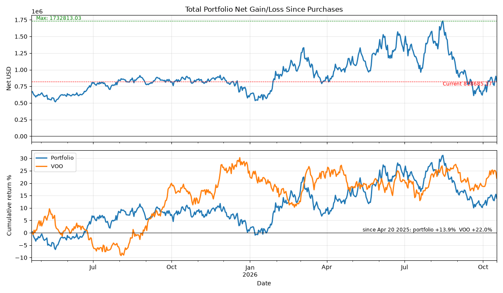
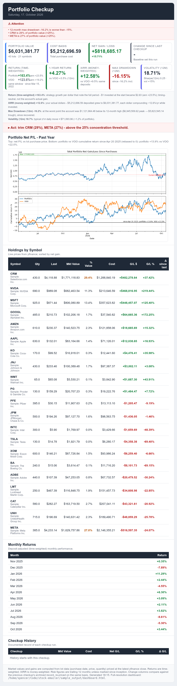

# stock-emailer

I have stocks parked in a bunch of different accounts, brokers, an
advisory, a few things I just hold because that's where I bought them
first. Each one has its own app, and each one tells you how *it's* doing.
None of them tell you how *you're* doing. And the one number I actually
care about is the total net gain across all of it, over time, since I bought. None
of them compute it for me.

So I built one. It's a daily email to myself.

Every morning (well, every cron run) it pulls a snapshot of my positions,
computes the numbers I don't want to compute by hand, draws the two
graphs, net gain and the cumulative-return curve, and sends the whole
thing to my inbox as an HTML email. I don't log in anywhere. I don't open a
portfolio app. The verdict lands where I already am.

The "daily" is just a cron. The *email* is the point.

## What it does

- Reads a position export (CSV: symbol, quantity, cost basis, acquisition
  date), and treats it as the single source of truth.
- Pulls a daily price series for each position, aligned back through the
  whole history.
- Computes, per day and in aggregate:

  - **Total net gain/loss since I bought**, across all positions, the
    number the chart is built around.
  - **Cumulative return** of the whole portfolio, and how it compares to a
    benchmark over the same window.
  - Position-level: current price, day change, gain basis, cost vs. market,
    contribution to the whole.
- Draws a **two-panel chart**: net P/L in $ over roughly the last year, and
  cumulative return % (portfolio vs. benchmark).
- Renders it into a **self-contained HTML email**: no attachments, no images
  fetched from a URL, the chart inlined as base64, then sends it via
  Amazon SES.
- Keeps a small **SQLite** ledger so a position you bought in January and
  still hold shows up with its whole arc, not just today.
- Ships as a **Docker image** with a cron baked in: one container, one
  `docker compose up -d`, and the email goes out on schedule. No host
  cron, no "where did I even run this" problem; the schedule lives in the
  container.

## What it looks like

One chart: net gain over the last year (top) and portfolio-vs-VOO
cumulative return (bottom).



And the email it becomes: the chart inlined, the summary cards on top.




The shape of it
---------------

One number, one chart, one email. The interesting part is the *pipeline*,
not any single widget:

```
  CSV export ──► SQLite lots ledger ──► price pull (daily close,
     (your brokers)      (lots.db)                per symbol, full history)
                                              │
                                              ▼
                                 returns.py: daily portfolio series,
                                 per-position metrics, drawdown, risk,
                                 concentration
                                              │
                                              ▼
                                 main.py: build_report_context()
                                              │
                          ┌───────────────────┴───────────────────┐
                          ▼                                       ▼
                    matplotlib                       email_utils.py:
                    two-panel chart                  build the HTML email,
                    (total_net.png)                  inline the chart (base64),
                                                                  │
                                                                  ▼
                                                         send via boto3 / SES
                                                         (or a dry-run that
                                                          just logs + saves)
```

Two deliberate choices:

1. **SQLite as the ledger.** Positions are *lots*, not snapshots. A lot has
   an acquisition cost and a date and lives in `lots.db`; the CSV is just
   what you feed it when your broker export reshuffles everything.
2. **The email is a product, an output.** The HTML is the artifact you're
   allowed to receive. It's self-contained, it's idempotent, and `dry_run`
   makes it testable with zero network.

## What "total net" means here

The chart is not "market value today minus market value then." It's sum,
over every lot you still hold, of

```
(price_today - your_adj_unit_cost) × qty_of_that_lot
```

The sum is floored at zero for lots you've sold, and dated only from the
lot's own acquisition date onward. So a position you fully exited contributes
nothing, and the line only ever moves forward in time. That's the
"total net gain over time" from the first line of the brief.

## Why a container

The "daily" has to happen even when I forget about it, so the whole thing
lives in Docker. One image, two services in one compose file:

- **the cron service.** Starts `cron`, writes its own crontab from what's
  persisted in the app (so the schedule is the same one the settings page
  shows, and UI and scheduler can't drift apart), then runs `main.py` on
  schedule. The job's stdout tees to a log the container owns, so
  `docker compose logs` shows the day it broke, not just that it's gone
  quiet.
- **the web service.** The same image under gunicorn, for the preview UI
  you open in a browser: render tomorrow's email today without waking the
  cron, edit a lot and the nightly email picks it up, because both
  services open the same SQLite file and it runs in WAL mode.

The data is a bind mount, not a single file, so you can replace
`FT_GainLoss.csv` on the host and the container sees the new version, not a
stale handle. Credentials are a *read-only* host mount next to the app;
nothing secret is written into the image. `DRY_RUN` defaults on, so the
container built from this repo will never email anyone until you flip it
off; and the port binds to the LAN address, not `0.0.0.0`, so the UI is
reachable from your network and nothing else.

```
docker compose up -d          # build the image, start both services
docker compose logs -f        # watch a live run
docker compose down           # stop everything, data is still there
```

That's the boring part: it runs on a machine I have to think about once a
year.

## Run it (synthetically)

```bash
pip install -r Code/requirements.txt

# from the repo root:
python3 run_sample.py
```

`run_sample.py` is a **seeded, offline** entrypoint for *this* repo. It:

- writes a synthetic position CSV + a synthetic daily price history into
  `seeds/` (deterministic, same numbers every run),
- builds the real SQLite ledger from them,
- runs the **real** `main.py` report pipeline end-to-end against that data
  (it swaps the live price pull for the seeded series, and nothing else
  is touched),
- renders the real `total_net.png` and the real, inlined email HTML,
- runs `dry_run`: **nothing is sent, nothing touches the network**, and
  the chart and the email preview land in `sample_output/` so you can
  open them in a browser.

So "does it actually work?" is not a question. The code in this repo is
the code that runs; the only fake in it is the numbers.

## Run it (for real)

```
Code/
  main.py            report pipeline: lots → returns → chart → context
  returns.py        report math (net, cumulative, drawdown, risk, concentration)
  lots_db.py        SQLite ledger + broker-CSV import (auto-normalizes headers)
  email_utils.py    SES client, HTML builder, dry-run
  sections.py       the HTML sections of the email report
  email_fmt.py      number/percent/delta formatting shared by all of it
  web/              the Flask UI you open in a browser to inspect/preview
  requirements.txt
```

Point `FT_GainLoss.csv` at your broker's gain/loss export (the
`Symbol/Qty/Adj Unit Cost/Date Acquired` shape; the importer is forgiving
and normalizes the usual header variants), set your SES env vars, and run
`main.py`. The Docker compose file wires the same thing with credentials
via the environment.

Credentials come from the environment (`~/.aws`, `.env`, or compose);
none are here. `FT_GainLoss.csv` is a placeholder name for *yours*; the
one checked in is synthetic.
